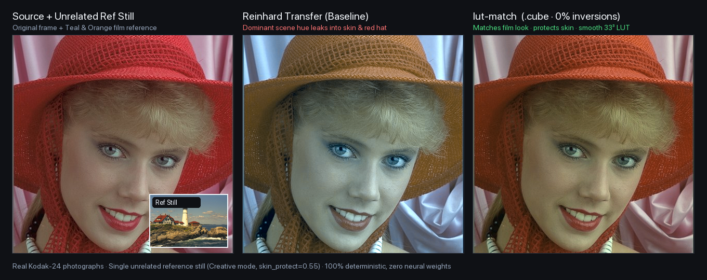
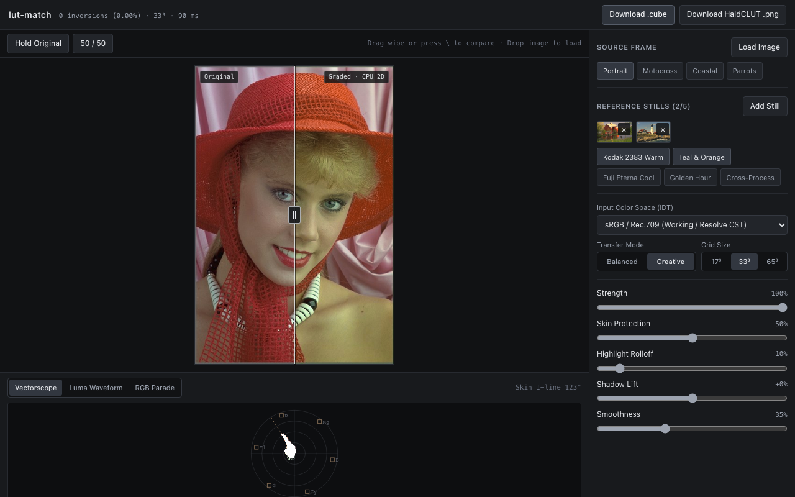

# lut-match

[Browser Studio](https://lumonopolis.github.io/lut-match/) · [Benchmarks](BENCHMARKS.md) · [Python CLI](#cli--python) · [TypeScript Core](#typescript--javascript) · MIT License

Open-source color-transfer libraries (`color-matcher`, Reinhard/MKL scripts) output pixels without a `.cube` LUT and wreck skin tones across mismatched scenes; palette LUT generators (`lutgen-rs`) target discrete desktop themes rather than film stills; and reverse-LUT tools (`img2lut`) require aligned before/after pairs of the same shot.

**`lut-match`** is a local, MIT-licensed solver and WebGL2 Studio that fits smooth, **zero-inversion Adobe `.cube` 3D LUTs** (`17³` / `33³` / `65³`) and HaldCLUT PNGs directly from **unrelated reference film stills** — with explicit skin protection, multi-still pooling, and 6 Rec.709 / camera Log IDTs.

<p align="center">
  
</p>

## What It Offers That Existing Tools Don't

| Tool | Works from unrelated film stills? | Exports smooth `.cube`? | Protects skin tones? | Surface | License |
| --- | --- | --- | --- | --- | --- |
| **`lut-match`** | **Yes (1–5 stills or pairs)** | **Yes (`0.00%` inversions)** | **Yes (OKLab I-line)** | **WebGL2 Studio + TS + Python** | **MIT** |
| `color-matcher` | Yes | No (pixel transfer only) | No (global stats) | Python | GPL-3.0 |
| `lutgen-rs` | No (discrete color palettes) | Yes | N/A | Rust CLI + Web | MIT |
| `img2lut` / reverse-LUT | No (same-photo before/after pairs) | Yes | Paired shots only | Python | Open-source |
| Commercial NLE / web matchers | Yes | Yes | Varies | Paid plugins / SaaS | Proprietary |

- **Protects skin tones and skies:** Naive global transfer leaks the reference scene's dominant background into faces and highlights. `lut-match` combines luminance-stratified OKLab tone and hue-harmonic curves with skin I-line protection and monotone 3D lattice projection (`0.00%` inversions in sRGB/Rec.709).
- **Works with 1 still or 5:** Use **`Creative`** mode for an expressive stylized push from a single unrelated still, or pool 3–5 stills in **`Balanced`** mode to cancel per-shot content bias and recover the underlying grade.
- **Built for real color pipelines:** Export working-space Rec.709/sRGB `.cube` files to sit behind a DaVinci Resolve CST node, or bake **Apple Log, Sony S-Log3, Panasonic V-Log, or Canon C-Log3** directly into the LUT for on-set monitors and FFmpeg.
- **Instant & deterministic:** Fits a `33³` LUT in **~25 ms** in Node/browser JS with zero neural weights, zero dependencies, and exact Python ↔ TypeScript parity (`< 6e-8` across all 6 IDTs).

## Browser Studio

Try it directly in your browser (100% client-side WebGL2, split-wipe compare, live Vectorscope / Luma Waveform / RGB Parade, 1-click `.cube` and HaldCLUT export): **[lumonopolis.github.io/lut-match](https://lumonopolis.github.io/lut-match/)**

<p align="center">
  <picture>
    <source media="(prefers-color-scheme: dark)" srcset="docs/assets/studio-dark.png" />
    <source media="(prefers-color-scheme: light)" srcset="docs/assets/studio-light.png" />
    
  </picture>
</p>

To run the Studio locally:

```bash
cd packages/lut-match-core && npm install && npm run build
cd ../../web && npm install && npm run dev
```

## CLI & Python

```bash
pip install -e ./python

# Fit a 33^3 .cube LUT from one or more reference stills (plus optional HaldCLUT PNG)
lut-match fit --src shot.png --ref look1.jpg --ref look2.jpg -o grade.cube --hald grade_hald8.png

# Stronger single-still look transfer with skin protection
lut-match fit --src shot.png --ref film_still.jpg -o creative.cube --mode creative --skin-protect 0.55

# Apply or inspect any .cube file
lut-match apply --lut grade.cube --in shot.png --out graded.png
lut-match inspect --lut grade.cube
```

```python
from lut_match import apply_lut, load_image, save_cube, solve_lut

src = load_image("shot.png")
ref = load_image("film_still.jpg")
lut = solve_lut(src, ref, size=33, mode="creative", skin_protect=0.5, idt="srgb")
save_cube(lut, "grade.cube", title="my-grade")
graded = apply_lut(src, lut)
```

## TypeScript / JavaScript

Zero-dependency core matching Python within `< 6e-8`:

```ts
import { fitLut, generateHaldClut, serializeCube } from 'lut-match-core';

const lut = fitLut({
  source,            // ImageDataLike | ImageDataLike[]
  references: [refStill],
  size: 33,
  mode: 'balanced',  // or 'creative'
  skinProtect: 0.5,
  idt: 'srgb',       // 'srgb' | 'rec709' | 'apple-log' | 'slog3' | 'vlog' | 'clog3'
});

const cubeText = serializeCube(lut);
const haldRgba = generateHaldClut(lut); // 512x512 Level-8 HaldCLUT
```

## DaVinci Resolve & FFmpeg

- **DaVinci Resolve (recommended CST workflow):** Export with default `idt="srgb"` and place `grade.cube` **after** your camera-to-Rec.709 Color Space Transform (CST) node. Use `--idt slog3` / `apple-log` / `vlog` / `clog3` only when you want a self-contained on-set monitoring LUT applied directly to raw camera log footage.
- **FFmpeg:**
  ```bash
  ffmpeg -i input.mp4 -vf "lut3d=file=grade.cube:interp=tetrahedral" -c:a copy graded.mp4
  ```

## At a Glance (Kodak-24 Real Photographs)

Evaluated across 24 public-domain Kodak photographs × 15 cinematic LUTs on held-out photos — full 3-regime tables, synthetic suite, visual contact sheets, and 6-IDT parity results live in **[BENCHMARKS.md](BENCHMARKS.md)**.

| Regime (Held-Out Real Photos) | `lut-match` ΔE00 ↓ | Best Transfer Baseline ↓ | `lut-match` Inversions |
| --- | ---: | ---: | ---: |
| **Paired look recovery** (`src=A, ref=LUT(A)`) | **1.43** | 1.50 (`mkl_oklab`, 4.0% inv) | **0.00%** |
| **5-still look transfer** (`5 src + 5 ref`) | **4.16** | 7.19 (`reinhard_lab`, 6.0% inv) | **0.00%** |
| **Unrelated single-still** (`1 src + 1 ref`) | **6.01** (`balanced`) / **7.59** (`creative`) | 12.59 (`reinhard_lab`, 8.5% inv) | **0.00%** |

## What a 3D LUT Can't Do

- **Single-frame ambiguity:** One unrelated reference still confounds scene palette with color grade. `Balanced` stays conservative near identity and converges as you add 3–5 stills; `Creative` pushes a stronger stylized look while guarding skin tones.
- **No spatial effects:** A `.cube` table maps `(R, G, B) → (R', G', B')` globally and cannot reproduce film grain, halation, bloom, or vignetting.
- **Baked wide-gamut Log IDTs:** The `0.00%` monotonicity guarantee holds on `srgb`/`rec709` working-space LUTs; baking a wide-gamut Log-to-Rec.709 3×3 matrix into the lattice introduces physically required negative off-diagonal terms along extreme gamut edges.

## License

MIT — see [LICENSE](LICENSE).
