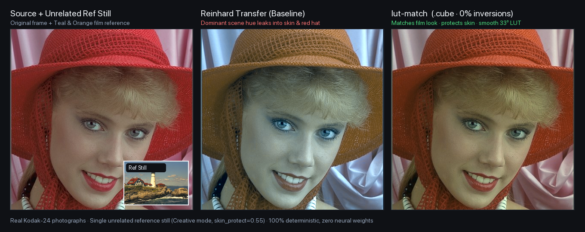

# lut-match

Fit smooth, zero-inversion Adobe `.cube` 3D LUTs (`17³` / `33³` / `65³`) and Level-8 HaldCLUT PNGs from one or more reference stills in Python.



- **Browser Studio (zero install):** https://lumonopolis.github.io/lut-match/
- **Source & Benchmarks:** https://github.com/Lumonopolis/lut-match

## Quickstart

```bash
pip install lut-match

# Fit a 33^3 .cube LUT from one or more reference stills
lut-match fit --src shot.png --ref look1.jpg --ref look2.jpg -o grade.cube --hald grade_hald8.png

# Expressive single-still transfer with skin protection
lut-match fit --src shot.png --ref film_still.jpg -o creative.cube --mode creative --skin-protect 0.55

# Apply or inspect a .cube LUT
lut-match apply --lut grade.cube --in shot.png --out graded.png
lut-match inspect --lut grade.cube
```

```python
from lut_match import apply_lut, load_image, save_cube, solve_lut

src = load_image("shot.png")
ref = load_image("film_still.jpg")
lut = solve_lut(src, ref, size=33, mode="creative", skin_protect=0.5, idt="srgb")
save_cube(lut, "grade.cube", title="my-grade")
graded = apply_lut(src, lut)
```

Supports 6 Input Device Transforms (`srgb`, `rec709`, `apple-log`, `slog3`, `vlog`, `clog3`), `Balanced` vs `Creative` transfer modes, and guarantees `0.00%` monotonicity inversions in sRGB/Rec.709 working space.
